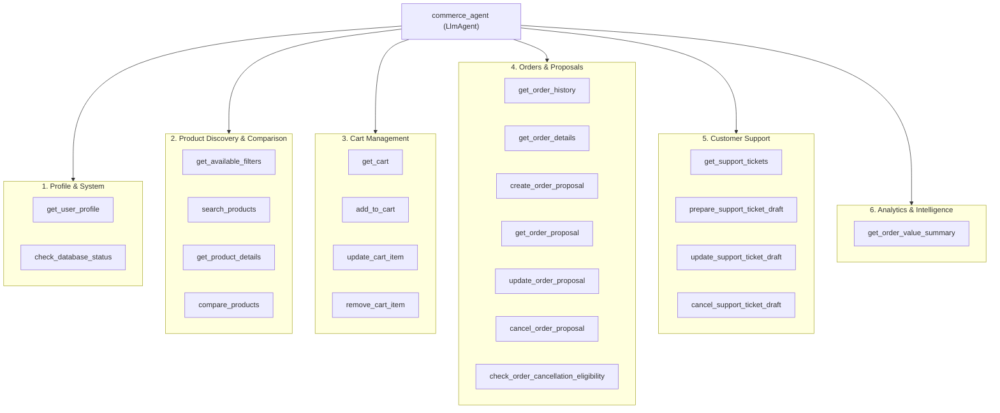
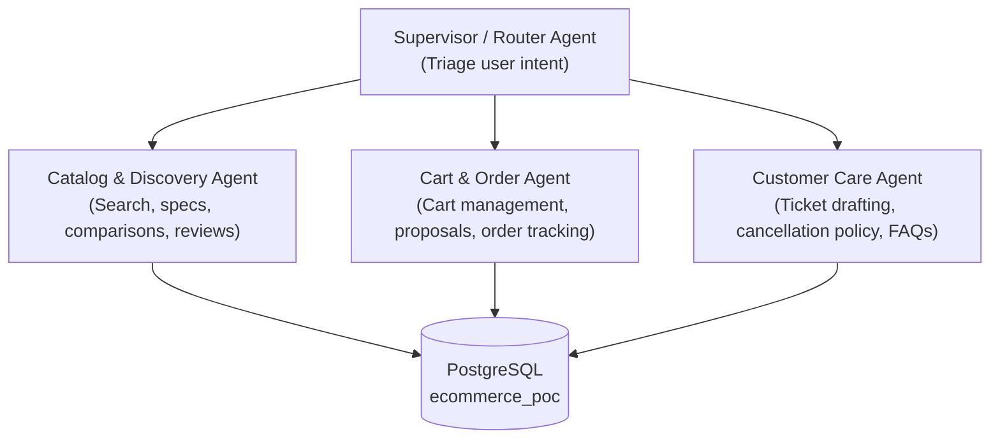

# AGENTS.md - Agent Architecture & Specification

This document provides a comprehensive operational and architectural specification of the AI agents implemented in this project using the **Google Agent Development Kit (ADK)**.

---

## 1. Agent Inventory

| Agent Name | Module Path | Framework Class | Model | Primary Role |
|---|---|---|---|---|
| **`commerce_agent`** | [`ecommerce_agent.agent`](ecommerce_agent/agent.py) | `google.adk.agents.LlmAgent` | `gemini-2.5-flash` | Enterprise E-Commerce Assistant (Product discovery, cart management, quote proposals, support triage, analytics) |
| **`weather_time_agent`** | `weather_time_agent.agent` | `google.adk.agents.LlmAgent` | `gemini-2.5-flash` | Standalone utility agent for weather & time queries |

---

## 2. Commerce Agent (`commerce_agent`) Deep Dive

### 2.1 Core Identity & Purpose
`commerce_agent` is the primary conversational intelligence engine for the e-commerce platform. It enables natural language shopping, product discovery, specification comparisons, shopping cart operations, quote proposals, order history inspection, and support triage against the `ecommerce_demo` PostgreSQL database (schema `ecommerce_poc`).

Exported in [`ecommerce_agent/agent.py`](ecommerce_agent/agent.py) as:
- `commerce_agent`
- `root_agent = commerce_agent` (for ADK CLI compatibility)

### 2.2 Dynamic Prompt & Context Injection
The agent uses a dynamic instruction generator: `build_commerce_agent_instructions()`. On every turn:
1. **Server-Enforced Identity**: Resolves the customer identity (`MOCK_USER_ID=1`, Asha Kumar) from server-side configuration. Customer ID is **never** accepted from Gemini tool calls.
2. **Profile Attachment**: Attaches the user's name, email, delivery address, preferred brands (e.g. *Dell, Lenovo*), and budget constraints (e.g. *₹60,000*) directly into the system prompt context.
3. **Profile Read-Only Guardrail**: The prompt strictly instructs the agent:
   > *"User profile details are read-only in this system. The customer cannot edit or change their personal details, email, or registered addresses via chat. If asked to change their name or email, explain that profile updates must be done through Account Settings."*

### 2.3 Two-Stage Approval & Deterministic Boundaries
To ensure safety and prevent hallucinated financial transactions:
1. **No LLM Order Placement**: The agent **cannot** directly place orders or charge payments. Instead, it calls `create_order_proposal`, generating an immutable 15-minute price snapshot (`order_proposals` table) and presents the proposal ID to the user.
2. **Deterministic UI Approval**: The actual order execution occurs when the user clicks an **"Approve & Checkout"** button in the frontend, which invokes `POST /api/proposals/{proposal_id}/approve`.
3. **Preview-Only Support Drafts**: The agent collects customer complaint details and creates an in-memory preview draft (`DFT-...`). Final ticket creation is triggered by the customer via `POST /api/tickets/drafts/{draft_id}/submit`.
4. **Order Cancellation Policy**: Placed orders cannot be modified (no editing items, quantities, or addresses). Orders can only be cancelled if their status is strictly `'placed'`. Once packed, shipped, or delivered, cancellation is prohibited.

---

## 3. Comprehensive Tool Catalog (22 Tools)

The agent is equipped with **22 function tools** organized into 6 domains. Every tool enforces customer ownership and parameterized database queries:



### 3.1 Domain 1: Profile & System
| Tool Function | Description | Key Parameters | Return Data |
|---|---|---|---|
| `get_user_profile()` | Fetches the authenticated customer's profile, preferences, and shipping address. | None (uses server context) | Customer name, email, preferences, address. |
| `check_database_status()` | Verifies live PostgreSQL connectivity, latency, and schema status. | None | Health status, version, database name. |

### 3.2 Domain 2: Product Discovery & Comparison
| Tool Function | Description | Key Parameters | Return Data |
|---|---|---|---|
| `get_available_filters(category_id)` | Dynamic filter discovery querying live DB for brands, price ranges, unnested tags, and JSONB specs. | `category_id` (optional) | Available categories, brands, price `min`/`max`, tags, and spec keys. |
| `search_products(...)` | Multi-criteria parameterized search across keywords, category, brand, price range, in-stock status, and JSONB specs. | `query`, `category_id`, `brand`, `min_price`, `max_price`, `in_stock_only`, `spec_filters` | List of matching products with ratings, pricing, and stock status. |
| `get_product_details(product_id)` | Retrieves detailed product specifications, category hierarchy, inventory count, and customer reviews. | `product_id` (int) | Comprehensive product specs, review ratings, stock level. |
| `compare_products(product_ids)` | Compares 2 to 4 products side-by-side, aligning shared specs and explicitly flagging missing specs. | `product_ids` (list[int], 2 to 4 items) | Side-by-side comparison matrix with highlight notes. |

### 3.3 Domain 3: Shopping Cart Management
| Tool Function | Description | Key Parameters | Return Data |
|---|---|---|---|
| `get_cart()` | Retrieves the customer's active shopping cart, itemized products, quantities, prices, and subtotal. | None | Cart ID, items list, unit prices, total amount. |
| `add_to_cart(product_id, quantity)` | Adds a product to the cart with inventory validation. Rejects requests exceeding stock. | `product_id`, `quantity` (default: 1) | Operation status, updated item count, subtotal. |
| `update_cart_item(product_id, quantity)` | Updates the quantity of an existing cart item. If `quantity=0`, removes the item. | `product_id`, `quantity` | Updated item details, new subtotal. |
| `remove_cart_item(product_id)` | Removes an item completely from the customer's cart. | `product_id` | Removal confirmation, new subtotal. |

### 3.4 Domain 4: Orders & Proposals
| Tool Function | Description | Key Parameters | Return Data |
|---|---|---|---|
| `get_order_history(limit)` | Lists past orders placed by the customer, sorted newest first. | `limit` (default: 10) | Order IDs, placement dates, status, total amounts, items summary. |
| `get_order_details(order_id)` | Retrieves full details for a specific order. Enforces customer row ownership. | `order_id` (int) | Line items, shipping address, payment method, tracking status. |
| `create_order_proposal(product_id, quantity)` | Creates an immutable 15-minute price snapshot in `order_proposals`. Does not reserve inventory or create orders. | `product_id`, `quantity` | Proposal ID, quoted price snapshot, expiry timestamp, status (`pending`). |
| `get_order_proposal(proposal_id)` | Checks the status, pricing, and expiration validity of a quote proposal. | `proposal_id` (int) | Proposal record, expiry countdown, validity boolean. |
| `update_order_proposal(proposal_id, quantity)` | Updates the quantity of an existing pending proposal instead of creating duplicates. | `proposal_id` (int), `quantity` (int) | Updated proposal record, recalculated total, renewed 15-minute price lock. |
| `cancel_order_proposal(proposal_id)` | Cancels / marks a pending proposal as cancelled when the customer rejects or withdraws it. | `proposal_id` (int) | Operation status, cancellation confirmation. |
| `check_order_cancellation_eligibility(order_id)` | Checks if an order can be cancelled based on business policy (`placed` status only). | `order_id` (int) | `can_cancel` (bool), current status, clear explanation. |

### 3.5 Domain 5: Customer Support
| Tool Function | Description | Key Parameters | Return Data |
|---|---|---|---|
| `get_support_tickets(status)` | Fetches the customer's existing support tickets. | `status` (optional: `'open'`, `'resolved'`, etc.) | Ticket IDs, subjects, descriptions, creation dates, status. |
| `prepare_support_ticket_draft(subject, description, order_id)` | Creates an in-session preview draft (`DFT-...`) for user review before submission. | `subject`, `description`, `order_id` (optional) | Draft ID, formatted preview, confirmation instructions. |
| `update_support_ticket_draft(draft_id, subject, description)` | Modifies the subject or description of an existing pending support draft instead of creating duplicates. | `draft_id`, `subject` (optional), `description` (optional) | Updated draft record for customer review. |
| `cancel_support_ticket_draft(draft_id)` | Discards / cancels a pending support ticket preview draft. | `draft_id` | Cancellation confirmation. |

### 3.6 Domain 6: Analytics & Intelligence
| Tool Function | Description | Key Parameters | Return Data |
|---|---|---|---|
| `get_order_value_summary()` | Computes total gross spending across valid orders (`placed`, `packed`, `shipped`, `delivered`), excluding cancelled orders. | None | Total spend, total valid orders, average order value, cancellation count. |

---

## 4. State & Persistence Separation

The architecture maintains a strict boundary between conversational state and transactional business data:

```text
+-----------------------------------------------------------------------------------+
|                              HEADLESS BACKEND SERVER                              |
+-----------------------------------------------------------------------------------+
          |                                                               |
          v                                                               v
+-------------------------------+                               +-------------------+
|      GOOGLE ADK ENGINE        |                               |   FASTAPI REST    |
|   (Conversational Memory)     |                               |   (Action APIs)   |
+-------------------------------+                               +-------------------+
          |                                                               |
          v                                                               v
+-------------------------------+                               +-------------------+
|     SQLite (.adk/session.db)  |                               | PostgreSQL        |
| - Session IDs                 |                               | (ecommerce_poc)   |
| - Message turns & history     |                               | - Products        |
| - LLM tool call events        |                               | - Orders & Items  |
| - In-memory drafts            |                               | - Proposals       |
+-------------------------------+                               | - Support Tickets |
                                                                +-------------------+
```

- **Conversation History**: Managed by Google ADK in SQLite (`.adk/session.db`). Can be migrated to PostgreSQL via ADK `DatabaseSessionService` without changing business database schemas.
- **Business Records**: Stored in PostgreSQL (`ecommerce_demo`, schema `ecommerce_poc`). All writes are atomic and parameterized.

---

## 5. Security & Safety Invariants

1. **Zero Arbitrary SQL Execution**: Gemini never writes raw SQL. All data access occurs through parameterized SQLAlchemy 2.x async repository methods.
2. **Server-Side Identity Boundary**: `user_id` is never accepted as an LLM argument. All repositories inject `MOCK_USER_ID` (or gateway identity header) on the server.
3. **No Financial Hallucinations**: Placed orders and ticket submissions cannot be committed by the model. The model only creates proposals and drafts; the user's browser executes direct REST actions with idempotency keys.
4. **Idempotency**: Repeated approval clicks for the same proposal return the existing order without duplicate charging or duplicate inventory deduction.

---

## 6. Future Multi-Agent Roadmap

While the POC uses a unified `LlmAgent`, the modular codebase is designed for seamless decomposition into specialized ADK subagents:



1. **`CatalogAgent`**: Specializes in vector semantic search, hybrid keyword matching, and multi-product technical comparisons.
2. **`OrderAgent`**: Manages cart mutations, discounts, proposal generation, and delivery tracking.
3. **`SupportAgent`**: Specializes in customer policy explanations, order cancellation verification, and ticket drafting.
4. **ADK A2A (Agent-to-Agent)**: The agents communicate over ADK's native subagent and runner interfaces.
