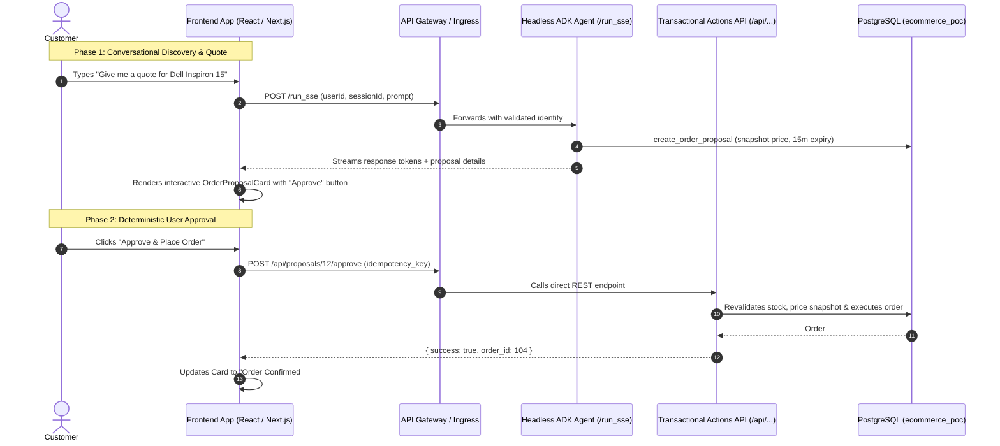

# Frontend Integration Guide for Google ADK E-Commerce Agent

This guide walks frontend developers through integrating a custom web or mobile application (React, Next.js, Vue, React Native, etc.) with the headless Google ADK e-commerce agent backend.

---

## 1. Architectural Overview

The backend operates as a **headless agent service**:
- **ADK Chat Engine (`/run_sse`)**: Handles conversational reasoning, product search, multi-criteria filtering, item comparisons, cart updates, and generating quote proposals.
- **Deterministic Action API (`/api/...`)**: Handles binding business transactions (order approval, ticket submission, order cancellation).



---

## 2. Managing Chat Sessions & State

Each conversation is scoped by:
- `appName`: `"ecommerce_agent"`
- `userId`: The customer ID provided by your authentication layer (e.g. `"1"`).
- `sessionId`: A client-generated UUID stored in `localStorage` or session storage.

### Session Lifecycle Pattern
1. **On App Mount**:
   - Check `localStorage.getItem("adk_session_id")`.
   - If present, call `GET /apps/ecommerce_agent/users/{userId}/sessions/{sessionId}` to load past messages.
   - If absent, generate a new UUID (e.g. `crypto.randomUUID()`) and store it.
2. **On New Message**:
   - Post to `/run_sse` with the current `sessionId`.
   - ADK automatically persists turns to `.adk/session.db`.
3. **On "New Chat" Action**:
   - Generate a fresh UUID and reset the local message list.

---

## 3. Consuming the Real-Time SSE Stream (`/run_sse`)

ADK streams chunks using standard Server-Sent Events (`text/event-stream`).

### Parsing Strategy
Each event is prefixed with `data: `:
```text
data: {"content": {"role": "model", "parts": [{"text": "Hello! "}]}, "partial": true, "turnComplete": false}
```

- When `part.text` is present, append the text chunk to the current message bubble.
- When `turnComplete: true` is received, finalize the message and re-enable the input field.

---

## 4. Production TypeScript API Client (`agentClient.ts`)

Create a client module to encapsulate all ADK and transactional API calls:

```typescript
// src/lib/agentClient.ts

export const BACKEND_URL = process.env.NEXT_PUBLIC_API_URL || "http://127.0.0.1:8000";

export interface ChatMessage {
  id: string;
  role: "user" | "model";
  text: string;
  timestamp: number;
}

export interface ApproveProposalPayload {
  payment_method?: string;
  shipping_address?: string;
  idempotency_key?: string;
}

export interface ApproveProposalResponse {
  success: boolean;
  order_id: number;
  proposal_id: number;
  status: string;
  total_amount: number;
  message: string;
}

/**
 * Streams real-time agent responses using Server-Sent Events (POST /run_sse).
 */
export async function* streamAgentChat(
  userId: string,
  sessionId: string,
  prompt: string
): AsyncGenerator<string, void, unknown> {
  const response = await fetch(`${BACKEND_URL}/run_sse`, {
    method: "POST",
    headers: {
      "Content-Type": "application/json",
      Accept: "text/event-stream",
    },
    body: JSON.stringify({
      appName: "ecommerce_agent",
      userId,
      sessionId,
      newMessage: {
        role: "user",
        parts: [{ text: prompt }],
      },
      streaming: true,
    }),
  });

  if (!response.ok || !response.body) {
    throw new Error(`Chat request failed with status: ${response.status}`);
  }

  const reader = response.body.getReader();
  const decoder = new TextDecoder("utf-8");
  let buffer = "";

  while (true) {
    const { value, done } = await reader.read();
    if (done) break;

    buffer += decoder.decode(value, { stream: true });
    const lines = buffer.split("\n");
    buffer = lines.pop() || "";

    for (const line of lines) {
      const trimmed = line.trim();
      if (!trimmed.startsWith("data:")) continue;

      const jsonStr = trimmed.replace(/^data:\s*/, "");
      if (!jsonStr) continue;

      try {
        const event = JSON.parse(jsonStr);
        if (event.content?.parts) {
          for (const part of event.content.parts) {
            if (part.text) {
              yield part.text;
            }
          }
        }
      } catch {
        // Skip unparseable partial chunks
      }
    }
  }
}

/**
 * Loads historical messages from SQLite session store.
 */
export async function fetchSessionHistory(userId: string, sessionId: string): Promise<ChatMessage[]> {
  const res = await fetch(`${BACKEND_URL}/apps/ecommerce_agent/users/${userId}/sessions/${sessionId}`);
  if (!res.ok) return [];

  const data = await res.json();
  const events = data.events || [];

  return events
    .filter((e: any) => e.content?.parts?.[0]?.text)
    .map((e: any, idx: number) => ({
      id: e.id || `hist_${idx}`,
      role: e.content.role === "model" ? "model" : "user",
      text: e.content.parts[0].text,
      timestamp: e.timestamp ? e.timestamp * 1000 : Date.now(),
    }));
}

/**
 * Direct REST action: Approves an order proposal.
 */
export async function approveProposal(
  proposalId: number,
  payload: ApproveProposalPayload
): Promise<ApproveProposalResponse> {
  const res = await fetch(`${BACKEND_URL}/api/proposals/${proposalId}/approve`, {
    method: "POST",
    headers: { "Content-Type": "application/json" },
    body: JSON.stringify(payload),
  });

  if (!res.ok) {
    const errorData = await res.json();
    throw new Error(errorData.detail || "Failed to approve proposal.");
  }

  return res.json();
}

/**
 * Direct REST action: Submits a support ticket draft.
 */
export async function submitTicketDraft(draftId: string) {
  const res = await fetch(`${BACKEND_URL}/api/tickets/drafts/${draftId}/submit`, {
    method: "POST",
  });

  if (!res.ok) {
    const errorData = await res.json();
    throw new Error(errorData.detail || "Failed to submit support draft.");
  }

  return res.json();
}

/**
 * Direct REST action: Cancels an order.
 */
export async function cancelOrder(orderId: number, reason?: string) {
  const res = await fetch(`${BACKEND_URL}/api/orders/${orderId}/cancel`, {
    method: "POST",
    headers: { "Content-Type": "application/json" },
    body: JSON.stringify({ reason }),
  });

  if (!res.ok) {
    const errorData = await res.json();
    throw new Error(errorData.detail || "Failed to cancel order.");
  }

  return res.json();
}
```

---

## 5. React Integration Hook (`useAgentChat.ts`)

A reusable React hook for chat streaming and session management:

```typescript
// src/hooks/useAgentChat.ts
import { useState, useEffect, useCallback } from "react";
import { streamAgentChat, fetchSessionHistory, ChatMessage } from "../lib/agentClient";

export function useAgentChat(userId: string) {
  const [sessionId, setSessionId] = useState<string>("");
  const [messages, setMessages] = useState<ChatMessage[]>([]);
  const [isStreaming, setIsStreaming] = useState<boolean>(false);
  const [error, setError] = useState<string | null>(null);

  // Initialize or restore session
  useEffect(() => {
    let sid = localStorage.getItem("adk_session_id");
    if (!sid) {
      sid = "sess_" + Math.random().toString(36).substring(2, 11);
      localStorage.setItem("adk_session_id", sid);
    }
    setSessionId(sid);

    // Load past session history
    fetchSessionHistory(userId, sid)
      .then((history) => {
        if (history.length > 0) setMessages(history);
      })
      .catch((err) => console.warn("Failed to load history:", err));
  }, [userId]);

  const sendMessage = useCallback(
    async (text: string) => {
      if (!text.trim() || isStreaming || !sessionId) return;
      setError(null);

      const userMsg: ChatMessage = {
        id: `user_${Date.now()}`,
        role: "user",
        text,
        timestamp: Date.now(),
      };

      const agentMsgId = `model_${Date.now()}`;
      const placeholderMsg: ChatMessage = {
        id: agentMsgId,
        role: "model",
        text: "",
        timestamp: Date.now(),
      };

      setMessages((prev) => [...prev, userMsg, placeholderMsg]);
      setIsStreaming(true);

      try {
        for await (const chunk of streamAgentChat(userId, sessionId, text)) {
          setMessages((prev) =>
            prev.map((m) => (m.id === agentMsgId ? { ...m, text: m.text + chunk } : m))
          );
        }
      } catch (err: any) {
        setError(err.message || "Failed to reach agent.");
        setMessages((prev) =>
          prev.map((m) =>
            m.id === agentMsgId
              ? { ...m, text: "I apologize, but I encountered an error communicating with the server." }
              : m
          )
        );
      } finally {
        setIsStreaming(false);
      }
    },
    [userId, sessionId, isStreaming]
  );

  const startNewChat = useCallback(() => {
    const newSid = "sess_" + Math.random().toString(36).substring(2, 11);
    localStorage.setItem("adk_session_id", newSid);
    setSessionId(newSid);
    setMessages([]);
    setError(null);
  }, []);

  return { sessionId, messages, isStreaming, error, sendMessage, startNewChat };
}
```

---

## 6. Interactive Component Patterns

### 6.1 Order Proposal Component (`OrderProposalCard.tsx`)
When Gemini outputs proposal details or proposal IDs (e.g. `Proposal #12`), the UI renders an approval card:

```tsx
// src/components/OrderProposalCard.tsx
import React, { useState } from "react";
import { approveProposal } from "../lib/agentClient";

interface Props {
  proposalId: number;
  productTitle: string;
  quantity: number;
  quotedPrice: number;
  onOrderPlaced?: (orderId: number) => void;
}

export const OrderProposalCard: React.FC<Props> = ({
  proposalId,
  productTitle,
  quantity,
  quotedPrice,
  onOrderPlaced,
}) => {
  const [loading, setLoading] = useState(false);
  const [status, setStatus] = useState<"pending" | "success" | "error">("pending");
  const [errorMsg, setErrorMsg] = useState("");
  const [orderId, setOrderId] = useState<number | null>(null);

  const handleApprove = async () => {
    setLoading(true);
    setErrorMsg("");
    try {
      const res = await approveProposal(proposalId, {
        payment_method: "credit_card",
        idempotency_key: `prop_${proposalId}_${Date.now()}`,
      });
      setStatus("success");
      setOrderId(res.order_id);
      if (onOrderPlaced) onOrderPlaced(res.order_id);
    } catch (err: any) {
      setStatus("error");
      setErrorMsg(err.message);
    } finally {
      setLoading(false);
    }
  };

  if (status === "success") {
    return (
      <div className="p-4 border rounded-lg bg-green-50 border-green-200">
        <h4 className="font-semibold text-green-800">Order Confirmed!</h4>
        <p className="text-sm text-green-700">Order #{orderId} has been successfully placed.</p>
      </div>
    );
  }

  return (
    <div className="p-4 border rounded-lg bg-white shadow-sm border-gray-200 my-2">
      <div className="flex justify-between items-center mb-2">
        <span className="text-xs font-semibold px-2 py-0.5 rounded bg-blue-100 text-blue-800">
          Order Proposal #{proposalId}
        </span>
        <span className="text-xs text-gray-500">15 min price snapshot</span>
      </div>
      <div className="font-medium text-gray-900">{productTitle}</div>
      <div className="text-sm text-gray-600">Quantity: {quantity}</div>
      <div className="text-lg font-bold text-gray-900 mt-1">₹{quotedPrice.toLocaleString()}</div>

      {status === "error" && (
        <div className="text-xs text-red-600 bg-red-50 p-2 rounded mt-2">{errorMsg}</div>
      )}

      <button
        onClick={handleApprove}
        disabled={loading}
        className="mt-3 w-full bg-blue-600 hover:bg-blue-700 text-white font-medium py-2 px-4 rounded text-sm disabled:opacity-50"
      >
        {loading ? "Processing Order..." : "Approve & Place Order"}
      </button>
    </div>
  );
};
```

---

## 7. Connecting Your Frontend

1. Ensure the backend server is running:
   ```bash
   python -m ecommerce_agent.server
   ```
2. In your frontend `.env.local` (or frontend configuration):
   ```env
   NEXT_PUBLIC_API_URL=http://127.0.0.1:8000
   ```
3. Test streaming by initiating chat requests with `userId="1"`.
4. Inspect the interactive documentation at `http://127.0.0.1:8000/docs` to test all schemas directly in Swagger UI.
